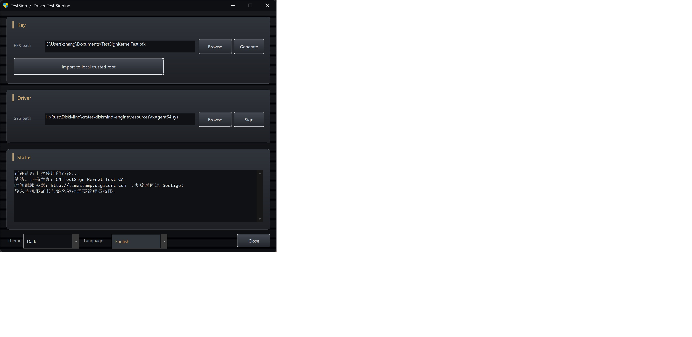

# TestSign

[简体中文](README_CN.md)

A small Windows tool for **kernel driver test-signing**. It generates a self-signed code-signing certificate, imports the public key into the local machine trust stores, and signs `.sys` files with SHA-256 plus an RFC 3161 timestamp.

The app must run as **Administrator** (required to write Local Machine certificate stores). Loading a test-signed driver still needs test signing enabled:

```bat
bcdedit /set testsigning on
```



## What it does

1. **Generate** — create an empty-password RSA-2048 / SHA-256 PFX (`CN=TestSign Kernel Test CA`).
2. **Import to local trusted root** — add the public certificate to Local Machine *Trusted Root Certification Authorities* and *Trusted Publishers*.
3. **Sign** — sign the selected `.sys` with SHA-256. Timestamp server: `http://timestamp.digicert.com` (falls back to Sectigo).

Last-used PFX/SYS paths, theme, and language are remembered under `HKCU\Software\TestSign`. The UI is English or Simplified Chinese (English by default) and can follow the Windows light/dark theme.
