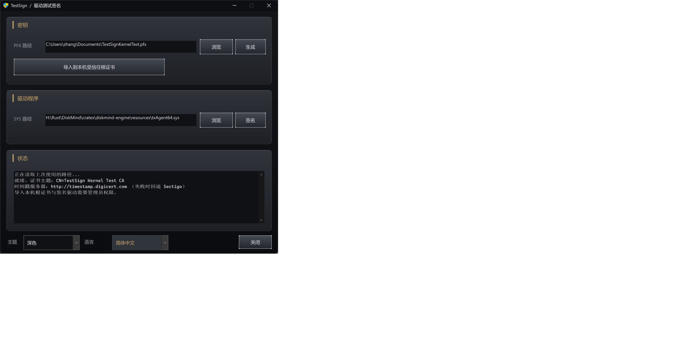

# TestSign

[English](README.md)

这是一个用于 **内核驱动测试签名** 的 Windows 小工具。它可以生成自签名代码签名证书、把公钥导入本机信任存储，用 SHA-256 加 RFC 3161 时间戳给 `.sys` 做嵌入签名，并可根据 INF + SYS 生成签过名的编录文件供 `pnputil` 入库。

程序需要以 **管理员** 身份运行（写入本机证书存储必需）。加载测试签名驱动前，本机仍需开启测试签名：

```bat
bcdedit /set testsigning on
```



## 功能

1. **生成** — 创建空密码的 RSA-2048 / SHA-256 PFX（`CN=TestSign Kernel Test CA`）。
2. **导入到本机受信任根证书** — 把公钥写入本机「受信任的根证书颁发机构」和「受信任的发布者」。
3. **签名** — 给所选 `.sys` 做 SHA-256 嵌入签名。够 `sc start` / CreateService 使用。时间戳服务器：`http://timestamp.digicert.com`（失败时回退 Sectigo）。
4. **编录** — 如有 SYS 先嵌入签名，必要时拷到 INF 同目录，调用 WDK `inf2cat`，再给 `.cat` 签名。用 INF 做 `pnputil /add-driver` 入库必须走这一步。本机需要安装 Windows Driver Kit。

上次使用的 PFX/SYS/INF 路径、主题和语言会记在 `HKCU\Software\TestSign`。界面支持英文和简体中文（默认英文），主题可跟随 Windows 浅色/深色。
